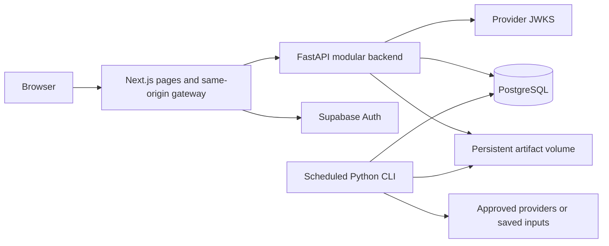

# System architecture

Target architecture, not existing code. [Audit](REPOSITORY_AUDIT.md), [decisions](DECISIONS.md), [API](API_SPECIFICATION.md), [database](DATABASE_SCHEMA.md).

## Topology and trust boundaries

One monorepo, one application domain, one API deployment. The CLI imports API domain modules and is a separately invoked process from the same image/codebase, not a microservice. No Redis/Celery/Kafka/vector database in MVP. Export jobs use a PostgreSQL jobs table and bounded worker invocation. Scientific fitting never runs in a web request.

Browser uses `/api/v1/*` on the web origin; the Next.js gateway forwards validated request metadata and the authenticated user's access token to FastAPI. It contains no financial calculations or ownership shortcuts. Auth endpoints are same-origin server handlers; public pages may call FastAPI server-to-server. API is internal in the default production topology; application JWT verification still applies. Auth tokens never imply ownership of arbitrary IDs.

Public analytics and workspace use the same metric/query services. Private content is never cached in a public page or analytics response. Public research is an explicit immutable publication projection; publishing is an operator CLI workflow, unavailable to ordinary users.

## Stack decisions

| Layer | Selected | Rationale / rejected alternative |
| --- | --- | --- |
| Web | Next.js App Router, React, strict TypeScript | Editorial server rendering and interactive app in one frontend; avoid a separate marketing codebase |
| UI | Tailwind + selected shadcn/ui primitives | Token consistency/accessibility; copy only needed primitives, not a large dashboard kit |
| Charts | Apache ECharts with explicit renderer imports | Lines/bars/scatter/model plots + static chart assets through one renderer; Recharts simpler React API but requires additional export/advanced plot work |
| Editor | Tiptap open-source core with React node views | Custom typed financial/evidence nodes and controlled persistence; BlockNote offers faster default block UI but adds an opinionated content layer. Build only needed block controls on established editor primitives |
| Client state | TanStack Query + local editor state, Zod | Server cache and boundary validation; avoid global Redux/CRDT in single-author MVP |
| API | FastAPI, Pydantic, SQLAlchemy, psycopg, Alembic | Typed REST and shared Python research domain; Next route handlers alone would duplicate scientific/data logic |
| Database | PostgreSQL, app schema, JSONB + relational projections | Transactions, versioning, exact numeric data and ownership; no document database needed |
| Auth | Supabase Auth, asymmetric JWT/JWKS, email/password | Managed verification/reset/session lifecycle; do not write a password database. Auth.js would add another auth service boundary for Python; Clerk is viable but no material advantage here |
| Research | Python 3.13 candidate, pandas/NumPy/SciPy/statsmodels | Existing Python archive and deterministic statistical workflow; compatibility smoke test selects exact pins |
| Tooling | pnpm, uv, Ruff, pytest, Vitest, Playwright, GitHub Actions | Two resolved lockfiles and generated OpenAPI client |
| Infrastructure | Docker Compose local; single VM app with managed PostgreSQL and persistent artifacts | Simple HTTP/worker/storage lifecycle. Vercel Functions/Services remain a later hosting option; no platform-specific feature is needed for MVP |

Versions must be selected from supported releases and locked at foundation. Existing Python 3.13 cache files are evidence of prior execution, not a dependency lock. Tiptap [custom nodes](https://tiptap.dev/docs/editor/extensions/custom-extensions/create-new/node) and BlockNote [custom blocks](https://www.blocknotejs.org/docs/features/custom-schemas/custom-blocks) confirm extension mechanisms; final editor proof-of-concept must test selection, undo and node views before committing the integration.

## Backend modules and ownership

`auth`: verified principal/JWKS; `users`: profile/preferences; `documents`: JSON schema, revision transactions and projections; `charts`: definitions, saved instances and resolved contexts; `insights`: operations on document insight nodes; `evidence`: hypothesis and evidence-link validation; `metrics`: metric registry/query; `datasets`: manifests/publication; `ingestion`: provider adapters and validation; `research`: model registry/readiness/run serialization; `exports`: revision rendering/jobs; `publications`: reviewed public content; `storage`: safe artifact IDs.

HTTP handlers call service functions; services transact using repositories. No SQL or provider HTTP in React components. No HTTP calls between modules of the same backend. No user-supplied Python, formula strings or SQL execution.

## Repository map to create after approval

- `apps/web/src/app`: canonical public/workspace/auth routes; `features/{charts,editor,documents,auth}`; `components/ui`; `lib/api`; `lib/navigation`; `styles/tokens.css`.
- `apps/api/src/near_api`: modules above, `main.py`, `settings.py`, `cli.py`; `apps/api/alembic`, `tests`.
- `packages/shared-types`: generated OpenAPI TS client, not a second metric definition source.
- `research/models`: fixed model specs/configs and pure fitting code imported by the CLI; `research/reports`: new release manifests; retain existing research directories unchanged.
- `scripts`: environment/preflight/reproduction wrappers; `.github/workflows`: checks/build/release. Create directories only with their first functional file or an explanatory README.

## Critical consistency rules

A dataset moves staged → validated → approved; publishing its active pointer is atomic. An immutable document revision stores editor schema version, full JSON, content hash, definition references and resolved dataset pins. A live working view may resolve latest data, but saving/exporting always freezes what is used. Models reference one immutable prepared dataset and pipeline code/lock/config hashes. A source revision creates a new version; no update-in-place.

Limits: 200 top-level blocks, 2 MiB document JSON, 10 MiB bounded user table data, 20 chart references but only visible/selected charts mounted, 366 daily query points initially, configurable maximum model sample from fixed specs. These provisional limits are acceptance constraints; increase only after profiling. Large arrays belong to shared dataset artifacts, not copied into chart blocks.
